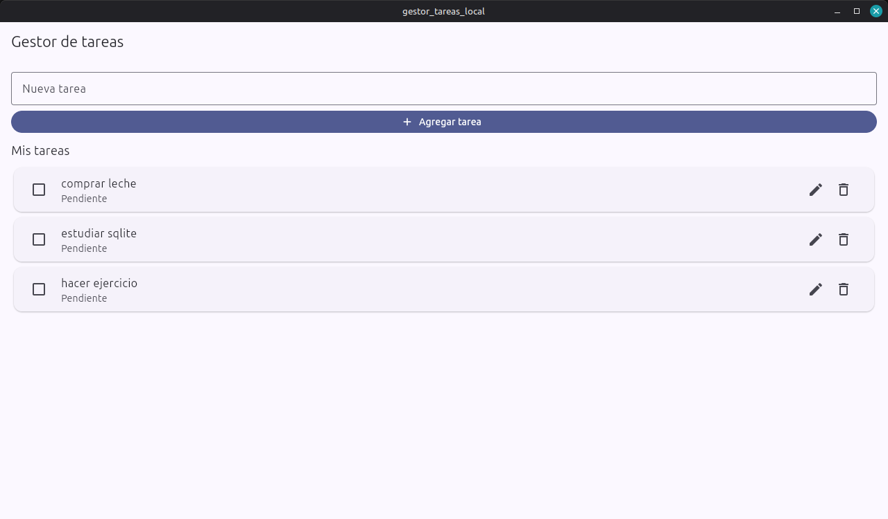
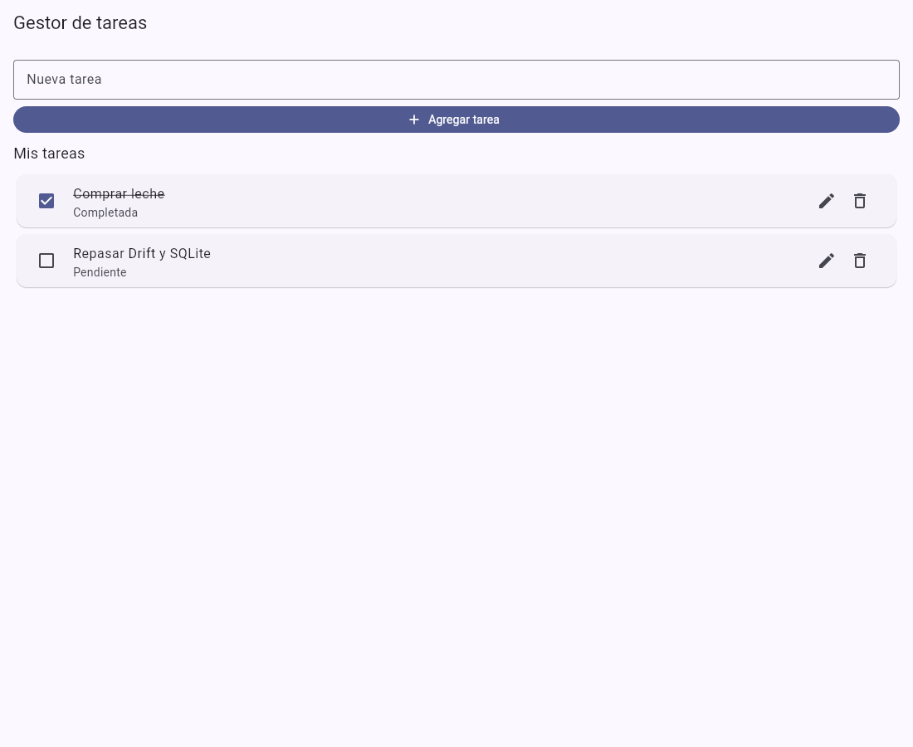

# Gestor de tareas local con SQLite (multiplataforma)

Aplicación Flutter que administra tareas de forma **totalmente local**, sin servidor, sin
MySQL y sin conexión a internet. Una sola base de código para Android, iOS, Windows, Linux,
macOS y web.

> Práctica de *Programación de Dispositivos Móviles* — Ingeniería en Sistemas Computacionales,
> Universidad Autónoma de Aguascalientes.

## Estado del desarrollo

| Etapa | Alcance | Estado |
| --- | --- | --- |
| 1. Preparación y diseño | Dependencias, decisión de persistencia y esquema de la tabla | Completada |
| 2. Persistencia real | Apertura de la base, alta y consulta | Completada |
| 3. Operaciones restantes | Edición, cambio de estado, eliminación y validación | Completada |
| 4. Compatibilidad y pruebas | Web (wasm + worker), plataforma nativa y pruebas automatizadas | Completada |

## Tecnología de persistencia elegida

**SQLite mediante [Drift](https://drift.simonbinder.eu/) 2.35.4 y
[drift_flutter](https://pub.dev/packages/drift_flutter) 0.3.1.**

### ¿Por qué Drift y no otra opción?

- `sqflite` solo cubre Android/iOS/macOS: dejaría fuera web, Windows y Linux, que son
  requisito de la práctica.
- Usar `sqlite3` a mano obliga a escribir SQL, mapear filas y abrir la base de forma distinta
  en cada plataforma.
- **Drift** es una capa tipada sobre SQLite que funciona en las seis plataformas, genera el
  código de tablas y consultas con `build_runner`, ofrece *streams* reactivos (la lista se
  actualiza sola después de cada escritura) y permite inyectar una base en memoria para las
  pruebas.
- **drift_flutter** aporta `driftDatabase(...)`, que elige automáticamente el motor adecuado:
  SQLite nativo (FFI) en Android, iOS, Windows, Linux y macOS; SQLite compilado a WebAssembly
  en el navegador.

La información **no se sincroniza entre dispositivos**: cada instalación y cada origen web
tienen su propia base. Eso es intencional.

## Diseño de la tabla

Tabla `tareas`, definida como una tabla Dart de Drift (`lib/data/app_database.dart`):

| Columna | Tipo SQLite | Restricciones | Propósito |
| --- | --- | --- | --- |
| `id` | `INTEGER` | `PRIMARY KEY AUTOINCREMENT NOT NULL` | Identificador único |
| `titulo` | `TEXT` | `NOT NULL`, no vacío (validado en la app) | Texto de la tarea |
| `completada` | `INTEGER` | `NOT NULL DEFAULT 0`, `CHECK (completada IN (0, 1))` | Estado pendiente/completada |

Equivalente SQL que genera Drift:

```sql
CREATE TABLE tareas (
  id INTEGER NOT NULL PRIMARY KEY AUTOINCREMENT,
  titulo TEXT NOT NULL,
  completada INTEGER NOT NULL DEFAULT 0 CHECK (completada IN (0, 1))
);
```

### Identificación de registros

- El `id` es un `INTEGER PRIMARY KEY`, que en SQLite es un alias del `rowid` (entero de 64
  bits). `AUTOINCREMENT` garantiza que un id eliminado no se reutilice.
- El id **lo asigna SQLite**, nunca la interfaz: al insertar se omite y Drift devuelve el id
  generado. Editar, cambiar estado y eliminar usan `WHERE id = ?`.
- SQLite no tiene tipo booleano: `completada` se guarda como `0`/`1` y Drift lo expone como
  `bool`.

## Arquitectura

```
lib/
├── main.dart                  # arranque, tema y creación de la base
├── data/
│   ├── app_database.dart      # tabla Tareas, apertura y operaciones CRUD
│   ├── app_database.g.dart    # generado por build_runner (no se edita a mano)
│   └── validacion_tarea.dart  # reglas de validación del título
└── screens/
    └── tareas_page.dart       # interfaz: alta, lista, edición, estado y eliminación
```

> El modelo `Tarea` que usa la interfaz es la clase que genera Drift a partir de la
> tabla, por lo que no se mantiene un segundo modelo escrito a mano.

Decisiones de diseño:

- **Una sola instancia** de `AppDatabase` por aplicación, creada fuera de `build()`.
- **Sin consultas dentro de `build()`**: la lista se obtiene con un `Stream` creado en
  `initState` y se muestra con `StreamBuilder`; Drift vuelve a emitir cuando cambia la tabla.
- **Escrituras asíncronas** (`await`) con manejo de errores y mensajes comprensibles.
- **Validación** centralizada en `validarTitulo` con `trim()`: se rechazan títulos vacíos,
  compuestos solo por espacios o de más de 200 caracteres. La misma regla se usa al crear y
  al editar.
- **Confirmación antes de eliminar** y mensajes de error comprensibles si una escritura falla.
- **Cierre de recursos**: el `TextEditingController` se libera en `dispose()`; la base se
  mantiene abierta durante la vida de la app y las pruebas la cierran explícitamente.

## Ubicación de la base de datos

`drift_flutter` guarda el archivo `gestor_tareas.sqlite` en la carpeta de documentos que
`path_provider` asigna a la aplicación:

- **Android:** almacenamiento privado de la app (`/data/data/<paquete>/app_flutter/`).
- **iOS y macOS:** carpeta `Documents` del *sandbox* de la app.
- **Windows:** carpeta Documentos del usuario.
- **Linux:** directorio XDG de documentos del usuario.
- **Web:** no hay archivo; Drift usa el sistema de archivos privado del origen (OPFS) o
  IndexedDB en el navegador.

Desinstalar la app (o borrar los datos del sitio en el navegador) elimina la base.

## Web: WebAssembly y worker

El navegador no incluye SQLite. Drift necesita dos archivos en `web/`, descargados de la
misma versión de Drift que usa `pubspec.lock`:

- `sqlite3.wasm`: SQLite compilado a WebAssembly.
- `drift_worker.dart.js`: worker que ejecuta la base fuera del hilo principal y coordina
  varias pestañas.

En esta práctica se obtienen del *release* `drift-2.35.4`
(<https://github.com/simolus3/drift/releases/tag/drift-2.35.4>) y **ya están incluidos en el
repositorio**. El asset del release se llama `drift_worker.js`; en el proyecto se guarda como
`drift_worker.dart.js`, que es el nombre que se pasa a Drift (el nombre es libre, la versión es
lo que importa).

| Archivo | Tamaño | SHA-256 |
| --- | --- | --- |
| `web/sqlite3.wasm` | 758 836 B | `e7451780e78c56ff864fe9317a0fbcd6aeb2e8de3beba7f5efd963202f7ec3d9` |
| `web/drift_worker.dart.js` | 363 283 B | `48c950cd8e3bc3cddb34816c860e228be8832bef07a297c27e9907c057ff8162` |

`flutter run` ya sirve el `.wasm` con `Content-Type: application/wasm`. Sin cabeceras
COOP/COEP, Drift utiliza IndexedDB (más lento, pero persistente); con ellas usa OPFS.

## Verificación en plataformas

### Plataformas ejecutadas

| Plataforma | Versión / forma de ejecución | Resultado |
| --- | --- | --- |
| **Linux (nativa)** | Flutter 3.47.0, Linux Mint 22.3; `flutter run -d linux` y prueba de integración | Correcto |
| **Web (Chrome)** | Chrome 158, build release servida en `http://127.0.0.1:8080` | Correcto |

La app nativa guarda la base en `~/Documents/gestor_tareas.sqlite`. La versión web se sirvió
con `tool/serve_web.py` (origen fijo, MIME `application/wasm`). Sin cabeceras COOP/COEP,
Drift informó `WasmStorageImplementation.sharedIndexedDb` y persistió correctamente.

**No ejecutadas:** Android, iOS, macOS y Windows. Android tiene SDK 36 instalado, pero las
licencias no están aceptadas y no hay emulador; iOS/macOS requieren una Mac y Windows requiere
Windows. El código y las dependencias están preparados para las seis plataformas.

### Comprobaciones P1–P6

| ID | Dónde se comprobó | Resultado |
| --- | --- | --- |
| P1 | Linux: app real, 3 altas desde la interfaz y cierre/reapertura completa | Las 3 permanecen |
| P2 | Linux (app real + reinicio) y Chrome (recarga + reinicio) | El estado se conserva |
| P3 | Linux (app real + reinicio) y Chrome (recarga + reinicio) | El título nuevo se conserva |
| P4 | Linux (app real + reinicio) y Chrome (recarga + reinicio) | La tarea no reaparece |
| P5 | Linux y Chrome | El título vacío/solo espacios no se registra |
| P6 | Chrome: recarga, cierre/reapertura de pestaña y reinicio completo con el mismo perfil | Los datos permanecen |

Evidencias (capturas de la app tras reiniciar):

- Linux: 
- Web: 

En web, el almacenamiento queda asociado al **origen** (`127.0.0.1:8080`) y al **perfil** de
Chrome. Cambiar de puerto, de perfil, usar modo incógnito o borrar los datos del sitio implica
empezar sin datos; es una limitación del almacenamiento del navegador, no de la app.

## Cómo ejecutar

```bash
flutter pub get
dart run build_runner build    # regenera app_database.g.dart si cambia el esquema
flutter analyze
flutter test                   # pruebas unitarias y de widgets
flutter run -d linux           # plataforma nativa (o windows, macos, android, ios)
```

Prueba de integración en una plataforma de escritorio real:

```bash
flutter test integration_test/app_test.dart -d linux
```

Web:

```bash
flutter build web
python3 tool/serve_web.py build/web 8080
# abrir http://127.0.0.1:8080 en Chrome
```

También se puede usar `flutter run -d chrome`. Para habilitar OPFS en web (opcional):

```bash
flutter run -d chrome \
  --web-header=Cross-Origin-Opener-Policy=same-origin \
  --web-header=Cross-Origin-Embedder-Policy=require-corp
```

## Pruebas

- `test/validacion_tarea_test.dart` (6): normalización y validación del título (vacío, solo
  espacios, máximo de 200 caracteres).
- `test/app_database_test.dart` (4): alta/consulta ordenada, edición, cambio de estado,
  eliminación por id y persistencia de cada cambio al **cerrar y reabrir** una base SQLite en
  archivo.
- `test/widget_test.dart` (6): apertura de la interfaz, alta, rechazo de títulos en blanco,
  edición, cambio de estado y eliminación con confirmación.
- `integration_test/app_test.dart` (1): P1–P5 sobre la app Linux real, con la base persistente
  de la app, y comprobación tras cerrar y reabrir la base. Deja dos tareas con prefijo
  `Prueba Linux`; al iniciar, borra solo esas filas para poder repetir la prueba.
- Web (P6): recarga, cierre/reapertura de pestaña y reinicio completo de Chrome con el mismo
  perfil y origen; comprobado de forma manual/asistida y documentado arriba.

`flutter test` ejecuta 16 pruebas y `flutter test integration_test/app_test.dart -d linux`
ejecuta la prueba de integración.

`app_database.g.dart` se versiona para que el repositorio se pueda clonar y ejecutar sin
regenerar el código; si se modifica el esquema, se regenera con `dart run build_runner build`.

## Referencias

- Drift: <https://drift.simonbinder.eu/>
- Drift en web: <https://drift.simonbinder.eu/platforms/web/>
- `drift_flutter`: <https://pub.dev/packages/drift_flutter>
- Persistencia con SQLite en Flutter: <https://docs.flutter.dev/cookbook/persistence/sqlite>
- Pruebas en Flutter: <https://docs.flutter.dev/testing/overview>
